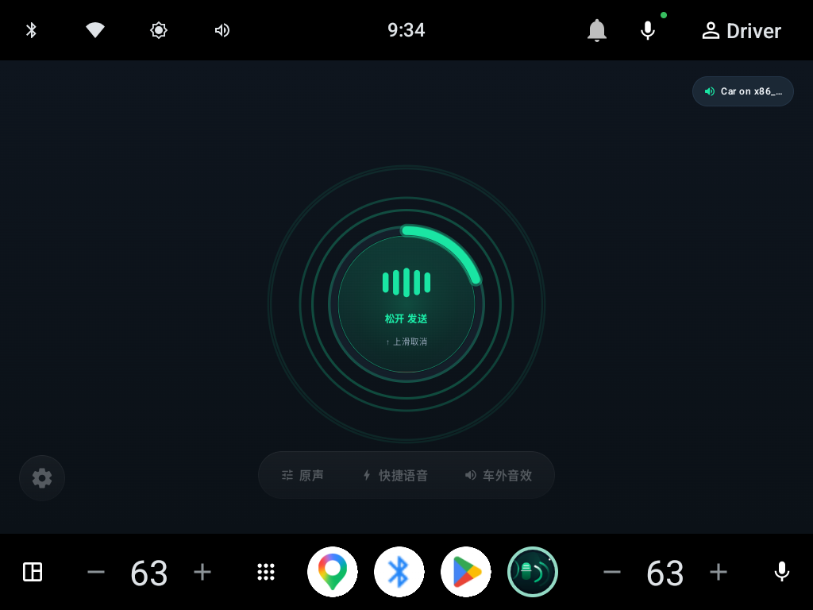
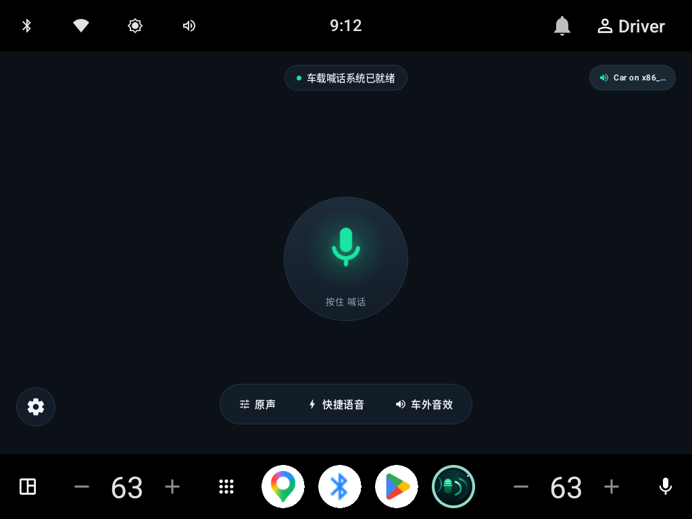
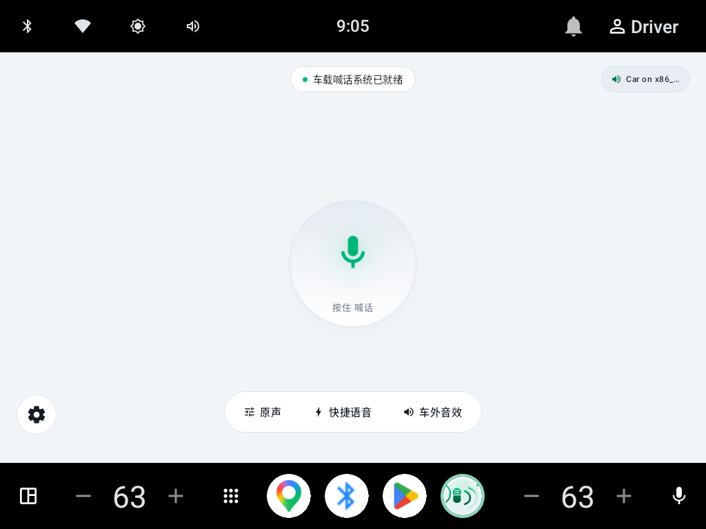
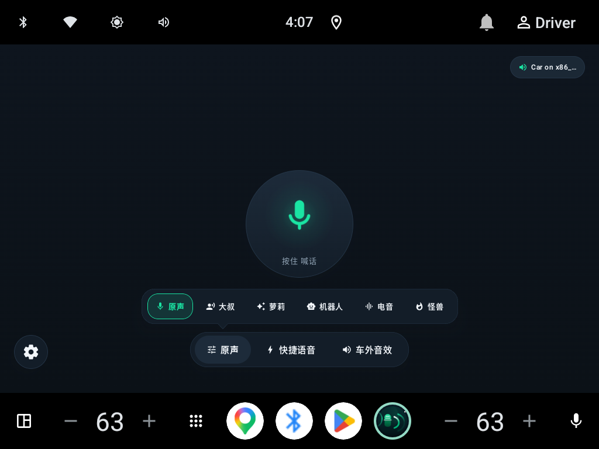
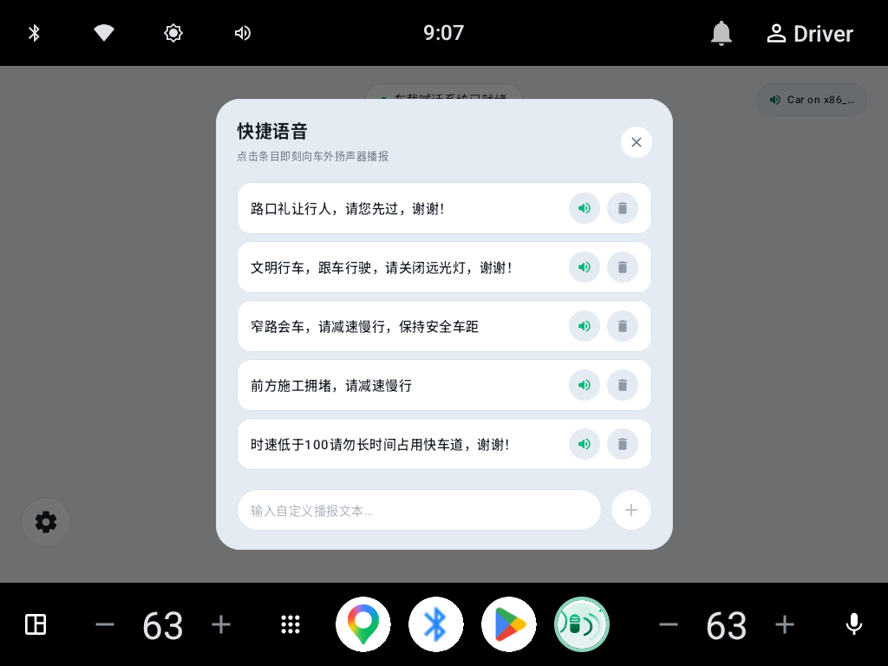
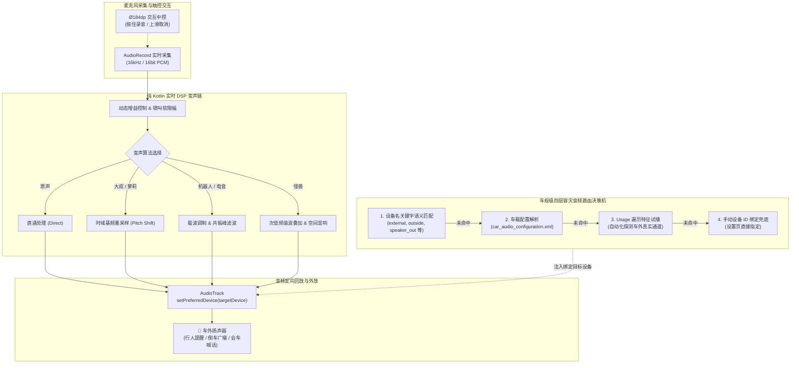

<div align="center">

# 吼 (Holler) - 车规级车外定向喊话与车载外放广播系统

<p align="center">
  
</p>

### “一按即说，声达车外。”

**专为 Flyme Auto 智能座舱量身打造的新一代车规级车外定向扬声交互、实时 DSP 变声与车载外放广播系统。**

<p align="center">
  <a href="https://github.com/vongzh/holler/releases"></a>
  
  
  
  <a href="https://github.com/vongzh/holler/releases"></a>
  <a href="LICENSE"></a>
</p>

</div>

---

## 📸 界面预览

<p align="center">
  
</p>
<p align="center">
  <em>图 1: 吼 (Holler) 车规级车外定向扬声、实时声波柱律动与 Alive Design 原生座舱交互主界面</em>
</p>

<br/>

<p align="center">
  
  
</p>
<p align="center">
  <em>图 2: 深色与浅色双模座舱深度适配（Alive Design 拟物态流体质感与微拟物磨砂玻璃 DOCK）</em>
</p>

<br/>

<p align="center">
  
  
</p>
<p align="center">
  <em>图 3: 底部车规级微拟物展开弹层（多维变声矩阵与车外礼让快捷语广播管理）</em>
</p>

---

## 🌟 项目简介

**吼 (Holler)** 针对以**领克 08 (Lynk & Co 08)** 为代表搭载**芯擎科技 龙鹰一号 (DragonHawk 1 / SE1000)** 7nm 高性能智能座舱芯片的车型深度定制研发，并广泛兼容基于 Android 11+ (API 30+) 的高通骁龙 **8155 / 8295** 等主流车规级大屏智能座舱生态。

系统打破了车载封闭系统对外部扬声器接口调用的物理与软件壁垒，基于 **Android Automotive Audio HAL 底层路由动态探测与四层容灾调度**、**纯 Kotlin 零原生依赖的低延迟实时 DSP 变声处理链**、**硬件级动态增益与啸叫防破音限幅 (AGC)**，深度融合 **Flyme Auto 原生座舱 Alive Design 设计语言**，为车主提供全天候、零感融入、随触即达的车外定向音频交互与广播体验：无论是礼让行人、狭窄会车喊话，还是倒车预警、趣味音效互动，均可“一按即说，声达车外”。

---

## ✨ 核心特性

| 功能模块 | 说明 | 状态 |
|---|---|:---:|
| 🎙️ **按住说话 (Push-to-Talk)** | Ø184dp 车规大热区主圆钮，按住采集、松开定向外放；毫秒级低延迟响应 | ✅ |
| 🛡️ **防误触取消机制** | 手指滑出圆钮（阈值 ≈ 90dp）即就地判定取消，加粗警示描边，防行车误发声 | ✅ |
| 🎛️ **实时 DSP 变声处理链** | 纯 Kotlin 算法自研：**原声 / 大叔 / 萝莉 / 机器人 / 电音 / 怪兽**，零 Native SO 依赖 | ✅ |
| 🔊 **四层容灾音频路由** | 设备名语义匹配 + 车载 XML 配置解析 + Usage 遍历试播 + 手动绑定兜底 | ✅ |
| 🎚️ **硬件增益与声学防破音 (AGC)** | 硬件级自动增益控制与软限幅滤波算法，有效抑制啸叫破音 | ✅ |
| ⏱️ **录音倒计时光环** | 15s 上限自适应环形进度，常规状态青绿律动、**最后 3 秒转红预警** | ✅ |
| ⚡ **全局桌面悬浮球** | 单击快捷播报 / 长按就地说话 / 边缘半隐藏贴靠，跨应用无缝调用 | ✅ |
| 💬 **TTS 快捷礼让语料库** | 内置文明会车/礼让语料，支持自建增删、语速音调调节与 ★ 常用置顶 | ✅ |
| 📢 **车外趣味音效箱 (Boombox)** | 优雅叮咚、短促鸣笛、倒车蜂鸣、口哨互动、防险警示长鸣与 440Hz 纯正弦基准校音 | ✅ |
| 🚗 **车机自动化与广播联动** | 标准 Intent 接收器，方控按键（自定义按键）与 Tasker / 快捷指令直连 | ✅ |
| 📡 **系统日志关键词触发** | 监听车辆 Logcat 事件（倒车、碰撞、紧急制动等）自动触发预警播报（带防抖冷却） | ✅ |
| 🎨 **Flyme Auto 双模主题** | 全令牌化色彩与微拟物材质体系，高对比度文本保证强光与夜间座舱可读性 | ✅ |
| 🔄 **开机自启与前台保活** | 随车通电开机自启常驻待命，通知栏快捷常驻微控制器 | ✅ |

---

## ⚙️ 核心架构与音频路由机制

### 整体音频数据流与控制链路



### 车外扬声器四层容灾路由详解

车载音频的难点在于不同车企、不同芯片平台（如芯擎龙鹰一号、高通 8155）及不同底层 HAL 对车外扬声器的挂载逻辑差异巨大。Holler 建立了**四级分层容灾策略**：

1. **设备名语义匹配**：枚举 `AudioManager` 获取系统全部 `AudioDeviceInfo`，基于车规中英文外部设备特征字库（`external`, `outside`, `exterior`, `speaker_out`, `车外`, `外置` 等）毫秒级过滤匹配；
2. **车载配置动态解析**：系统级读取 `/vendor/etc/`、`/odm/etc/` 或 `/system/etc/` 目录下的 `car_audio_configuration.xml`，深度解析车身 Zone 与物理外放设备的映射总线；
3. **Usage 遍历试播机制**：枚举 Android 系统级音频用途（`USAGE_ANNOUNCEMENT`, `USAGE_SAFETY`, `USAGE_EMERGENCY`, `USAGE_ASSISTANCE_NAVIGATION_GUIDANCE` 等），自动发射短音频特征流，支持车内快速听辨并锁定物理通道；
4. **手动设备 ID 绑定兜底**：在设置页「系统设置与参数诊断」中提供可视化的设备扫描清单，可强制固定目标输出设备 ID。

---

## 🎨 座舱设计语言与交互纪律

应用深度遵循 **Flyme Auto 原生设计规范** 与 **Alive Design 拟物态流体设计原则**：

```
┌────────────────────────────────────────────────────────┐
│     ● 车载喊话系统已就绪        Car on x86_64_emulator │ ← 状态胶囊（宽度自适应防挤压）
│                                                        │
│                     ╭────────────╮                     │
│                     │  ▮▮▮ 声波柱  │                   │ ← Ø184dp 主按钮 + Ø196dp 倒计时环
│                     │  松开 发送   │                   │
│                     │  ↑ 上滑取消  │                   │
│                     ╰────────────╯                     │
│                       按 住 喊 话                      │ ← 待机态（呼吸微光）
│                                                        │
│  ⚙️ 设置                                               │ ← 齿轮触控入口
│           [ 变声 ]   [ 快捷语音 ]   [ 车外音效 ]       │ ← 底部微拟物 DOCK（毛玻璃材质）
└────────────────────────────────────────────────────────┘
```

### 交互状态机规范

- **主按钮四态演进**：
  - **待机就绪态**：青绿色微光呼吸麦克风图标，平缓呼吸律动周期；
  - **按住录音态**：中心原位无缝切换为三段动态声波柱，伴随音量分贝实时跳动；外圈呈现 Ø196dp 动态外扩涟漪与 15s 倒计时环；
  - **末 3 秒预警**：倒计时环在前 12 秒维持就绪青绿，**进入最后 3 秒骤变警示红**，提醒车主及时收尾；
  - **上滑取消态**：手指滑出圆钮热区（位移阈值 ≈ 90dp）就地判定取消 —— **44dp 警示红 × 与 2dp 纯红描边直接显现，坚决不做渐变过渡**，直观告知车主发声已截断。
- **色彩与对比度纪律**：
  - 严格遵守 `青绿 = 就绪/安全工作`、`警示红 = 危险/取消/强时效压力` 的语义区分；
  - 浅色模式下针对小字号文本启用独立微调色阶，严格确保文本对比度 $\ge 4.5:1$。
- **拟物材质分家**：
  - **深色座舱**：采用均匀中性深色表面与冷色细微描边，杜绝暗底叠白导致的灰雾浑浊感；
  - **浅色座舱**：采用“真·薄玻璃”质感（微低 alpha 填充 + 顶高光亮边 + 底部暗投影），呈现通透立体的悬浮层级。

---

## 🚀 快速开始

### 固件与规格

| 当前版本 | 应用包名 | 最低系统 | 目标系统 | 开源协议 |
|---|---|---|---|---|
| **v0.3.1** (code: `4`) | `com.vongzh.holler` | Android 11 (API 30) | Android 17 (API 37) | Apache License 2.0 |

### 安装与快速部署（免编译）

从 [GitHub Releases](https://github.com/vongzh/holler/releases) 获取最新的 **`Holler-0.3.1.apk`**：

```bash
# 1. 安装 APK 到车机或车机模拟器
adb install -r Holler-0.3.1.apk

# 2. 授予车内麦克风录音权限（喊话必须）
adb shell pm grant com.vongzh.holler android.permission.RECORD_AUDIO

# 3. 启动应用
adb shell am start -n com.vongzh.holler/.ui.MainActivity
```

> ⚠️ **关于签名机制的兼容说明**：
> - Release 包采用正式签名发布；若设备之前安装过本地 `assembleDebug` 生成的调试包，由于签名证书不一致，会提示 `INSTALL_FAILED_UPDATE_INCOMPATIBLE`；
> - 遇到此问题时，请先执行 `adb uninstall com.vongzh.holler` 彻底卸载旧包（自建的快捷语料会被清空，请提前记录备忘）。

---

## 💡 高级联动与车机自动化

### 1. 全局桌面悬浮球

- **单按**：立刻触发最近一条常用（★ 标星）快捷语车外播报；
- **长按**：全局就地开启 Push-to-Talk 喊话，松手立即外放；
- **拖动与贴靠**：自由拖动至车机屏幕任意位置，松手自动贴附屏幕两侧半透明隐藏。

### 2. 方控按键与广播意图联动

支持通过方向盘自定义按键、语音助手、Tasker 或车载自动化引擎直接发送广播：

```bash
# 触发快捷语文本播报
adb shell am broadcast -a com.vongzh.holler.ACTION_SPEAK \
  --es text "文明行车，请关闭远光灯，谢谢！"

# 停止当前车外播报
adb shell am broadcast -a com.vongzh.holler.ACTION_STOP
```

### 3. Logcat 车辆日志关键词防抖触发

内置 `LogcatTriggerService` 服务，可监听底层车身事件（如倒车挡挂入、障碍物接近碰撞预警）：
- 命中关键词后自动播放指定预警音或 TTS；
- 内置防抖冷却时钟（默认 5s），避免在复杂泊车工况下重复高频触发打扰外界。

---

## 📂 项目结构

```
Holler/
├── app/src/main/java/com/vongzh/holler/
│   ├── audio/
│   │   ├── AudioRouteResolver.kt       # 车外扬声器定位引擎（设备扫描 / 配置解析 / 容灾调度）
│   │   ├── HollerEngine.kt             # 音频流引擎（AudioRecord 采集 + DSP 桥接 + AudioTrack 外放）
│   │   ├── PhraseStore.kt              # 快捷语料与配置持久化 + TTS 播放器 (PhraseSpeaker)
│   │   ├── UsageSweeper.kt             # AudioAttributes Usage 自动化测试遍历工具
│   │   ├── FloatingTalkService.kt      # 全局车机悬浮窗服务（手势监听与交互）
│   │   ├── HollerForegroundService.kt  # 前台保活与车机常驻通知快捷控制器
│   │   ├── LogcatTriggerService.kt     # 车辆运行日志关键词监听与防抖触发器
│   │   ├── HollerCommandReceiver.kt    # 方控按键 / Tasker 广播意图接收器
│   │   ├── BootReceiver.kt             # 通电开机自启动广播接收器
│   │   ├── shell/
│   │   │   └── DeviceProbe.kt          # 提权设备深度探测（基于 app_process）
│   │   └── dsp/
│   │       ├── VoiceEffect.kt          # 变声算法枚举（原声/大叔/萝莉/机器人/电音/怪兽）
│   │       ├── DspChain.kt             # 纯 Kotlin 实时 DSP 链（基频重采样/共振峰/滤波/AGC）
│   │       └── VoiceEffectBridge.kt    # 变声数据桥接流处理
│   └── ui/
│       ├── MainActivity.kt             # 主控界面：中控触控状态机 + 底部 DOCK + 设置弹层
│       ├── Controls.kt                 # Flyme Auto 车规级微拟物控件库（卡片/开关/滑块/按钮）
│       ├── CountdownRingView.kt        # 15s 环形倒计时进度控件（最后 3 秒骤变警示红）
│       ├── AudioEqualizerBars.kt       # 实时声波律动柱
│       ├── AudioGlowRippleView.kt      # 主按钮向外扩散流体光晕声波涟漪
│       ├── FloatingTalkView.kt         # 自绘轻量级座舱悬浮球控件
│       └── theme/                      # 色彩令牌 / 几何圆角 / 间距网格 / 深浅色双模
├── docs/                               # 完整设计规范、视觉审计报告与逆向对比资料
├── build.gradle.kts                    # 顶层构建脚本
└── settings.gradle.kts                 # 工程多模块配置
```

---

## 🛠️ 构建与编译

### 开发环境要求

| 组件 | 版本要求 | 说明 |
|---|---|---|
| **JDK** | **JDK 21** | 推荐使用 JetBrains Runtime 21 或 OpenJDK 21 |
| **Android Studio** | Ladybug (2024.2+) 或更新 | 完整支持 AGP 9.4.1 |
| **Gradle** | 9.8.1 | 已内置 Gradle Wrapper，免手动配置 |
| **AGP** | 9.4.1 | 内置现代化 Kotlin 编译支持 |
| **Kotlin** | 2.4.20 | 高性能协程与 Compose 运行时 |
| **Android SDK** | `compileSdk 37` / `minSdk 30` | 建议通过 SDK Manager 安装对应平台 |

### 命令行构建

```bash
# 1. 克隆代码仓库
git clone https://github.com/vongzh/holler.git
cd Holler

# 2. 编译调试版 APK
./gradlew assembleDebug

# 3. 安装到车机/测试机
adb install -r app/build/outputs/apk/debug/app-debug.apk
adb shell pm grant com.vongzh.holler android.permission.RECORD_AUDIO
```

---

## 📦 持续集成与自动化发版

本项目配备了工业级 GitHub Actions 持续交付流水线 ([`.github/workflows/android-release.yml`](.github/workflows/android-release.yml))，只需推送版本标签即可触发全自动构建发布：

```bash
# 1. 更新 app/build.gradle.kts 内的 versionCode 与 versionName
# 2. 提交代码更改
git commit -am "release: v0.3.2" && git push origin main

# 3. 推送版本 Tag 触发 CI 自动发版
git tag v0.3.2 && git push origin v0.3.2
```

流水线内置**三道严苛防呆校验**，确保发版质量坚如磐石：
1. **版本一致性强校验**：Git Tag 名与 `versionName` 必须强一致，严防发错版本；
2. **AAPT2 产物完整性检验**：自动化断言最终 APK 的包名、Min/Target SDK 及启动 Activity；
3. **签名前置安全截断**：未检测到官方签名 Secrets 时直接阻断发布，避免流出未签名无效包。

---

## 📚 项目技术文档索引

| 文档名称 | 核心内容 |
|---|---|
| 📐 [`docs/DESIGN.md`](docs/DESIGN.md) | Flyme Auto 视觉规范溯源、座舱设计令牌体系与布局推演记录 |
| 🔍 [`docs/AUDIT-2026-10-10.md`](docs/AUDIT-2026-10-10.md) | 主控界面全要素视觉审计报告（P0/P1/P2 问题整改全纪要） |
| 💻 [`docs/ENVIRONMENT.md`](docs/ENVIRONMENT.md) | 开发者环境配置避坑指南（JDK / SDK / 国内镜像加速 / 模拟器） |
| 🖥️ [`docs/EMULATOR_SETUP.md`](docs/EMULATOR_SETUP.md) | Android Automotive 车机系统镜像离线安装与调优步骤 |
| 📡 [`docs/ADB_PROBE.md`](docs/ADB_PROBE.md) | 领克等主流车机只读音频设备底层探测指令速查 |
| ⚖️ [`docs/GAP_VS_HEY.md`](docs/GAP_VS_HEY.md) | Holler 与竞品方案（Hey!）的技术全景差异与演进方向 |
| 🔬 [`docs/HEY_CAPABILITY.md`](docs/HEY_CAPABILITY.md) | 业界同类方案能力拆解与逆向技术对照参考 |

---

## ⚖️ 声明与安全边界

1. **功能域边界**：本项目严格限定于**座舱信息娱乐域**（车外扬声器定向语音播报、文明礼让 TTS、趣味音效互动）；
2. **车辆控制安全**：本项目**绝不涉及、绝不介入、亦不篡改**任何车辆底层动力系统、转向机构、制动控制、安全气囊或车身网关控制指令；
3. **文明守则**：使用车外广播发声功能时，请严格遵守《中华人民共和国道路交通安全法》及所在地相关法律法规，文明行车，严禁在医院、学校等禁鸣区域或夜间扰民；
4. **设计知识产权**：界面交互与设计语言参考 Flyme Auto，本项目开源代码中**绝不包含**任何 Flyme Auto / 魅族 / 吉利汽车的专有商业源码或非授权素材。

---

## 📄 开源许可证

本项目基于 [Apache License 2.0](LICENSE) 协议完全开源。

```
Copyright 2026 vongzh

Licensed under the Apache License, Version 2.0 (the "License");
you may not use this file except in compliance with the License.
You may obtain a copy of the License at

    http://www.apache.org/licenses/LICENSE-2.0
```

> **衍生作品署名规则**：任何个人或组织在转载、二次开发、修改或再分发本项目的衍生作品时，必须完整保留根目录的 [`LICENSE`](LICENSE) 与 [`NOTICE`](NOTICE) 版权及许可声明，并在修改过的文件中明确注明修改痕迹（依据 Apache-2.0 第 4(b) 条款规定）。第三方组件致谢清单详见 [`NOTICE`](NOTICE)。
